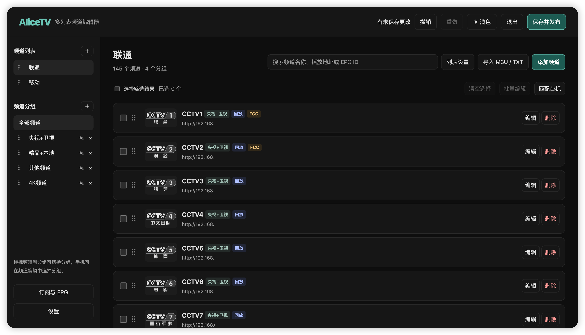
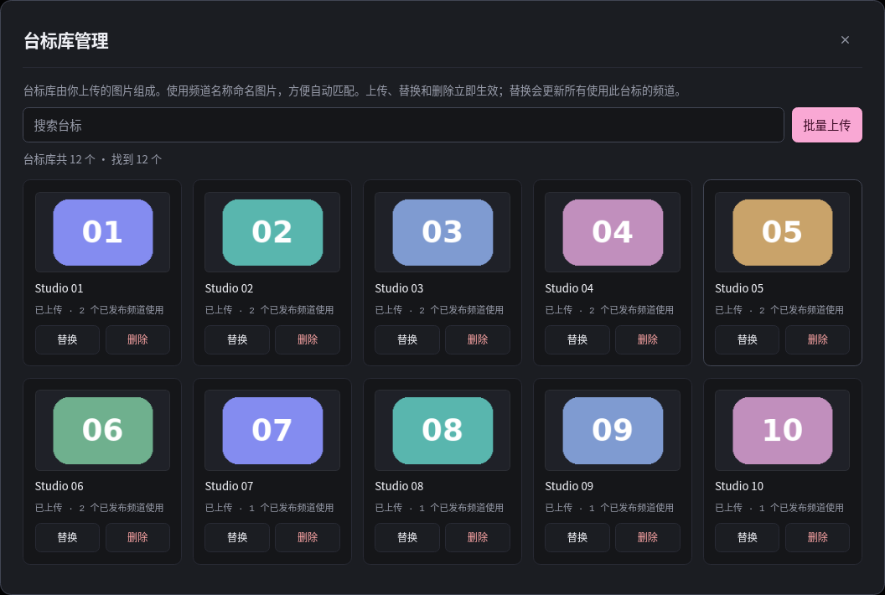
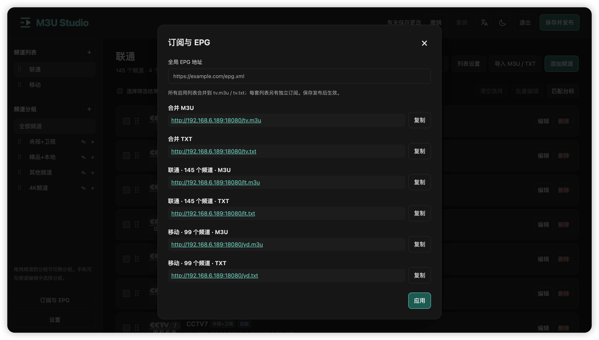

<p align="center">
  
</p>

<h1 align="center">M3U Studio</h1>

<p align="center">IPTV channel management and subscription server</p>

<p align="center">
  <a href="https://github.com/cachemiao/m3u-studio/releases"></a>
  <a href="LICENSE"></a>
  <a href="https://hub.docker.com/r/cachemiao/m3u-studio"></a>
  <a href="https://github.com/cachemiao/m3u-studio/stargazers"></a>
  <a href="https://t.me/m3ustudio_news"></a>
  <a href="https://t.me/m3ustudio_chat"></a>
</p>

<p align="center"><a href="README.md">简体中文</a> · <strong>English</strong></p>

An easy-to-deploy IPTV channel management and subscription server built with **Python / Flask**, supporting **M3U and TXT**. Manage multiple playlists, groups, channel logos and EPG in your browser, then publish subscriptions with customizable short URLs. Deploy with **Docker**.

Developed as a personal learning and hobby project, with source code released under the **GNU GPL v2.0 License**. The project does not include live stream sources or third-party channel logo images. Please contact the author through an [Issue](https://github.com/cachemiao/m3u-studio/issues) about any potentially infringing content.

Questions, bug reports and feature requests are welcome in [Issues](https://github.com/cachemiao/m3u-studio/issues).

- [Telegram news · @m3ustudio_news](https://t.me/m3ustudio_news): release updates, features and important notices.
- [Telegram community · @m3ustudio_chat](https://t.me/m3ustudio_chat): discussion, help and suggestions.

---

## Features

- **Multiple playlists:** separate subscriptions, custom short names, optional combined subscriptions, and drag-and-drop ordering of playlists, groups and channels.
- **Import and export:** import UTF-8 M3U / TXT and publish M3U / TXT subscriptions.
- **Logo library:** starts empty and supports search, local and batch uploads, and name matching. For duplicate names, choose to replace the existing image or stop the upload. Direct image URLs can be assigned separately.
- **Bulk editing:** change groups, EPG or FCC, or replace text in live and catch-up URLs; preview before applying.
- **EPG, catch-up and FCC:** configure channel EPG IDs, XMLTV URLs, catch-up parameters and fast channel switching parameters.
- **Undo and history:** undo/redo drafts, retain the last 30 pre-publish configuration snapshots, and export/restore JSON configurations.
- **Themes, languages and mobile:** light/dark/system themes, Chinese/English, responsive layout and touch dragging.
- **Local storage:** account, configuration and uploaded images stay in your data directory. The frontend has no external CDN dependency.

M3U Studio edits playlists and serves subscriptions. Stream URLs and EPG must be provided by the user. Stream forwarding, such as UDP-to-HTTP conversion, requires a separate service.

FCC requires [rtp2httpd](https://github.com/stackia/rtp2httpd) and the corresponding [FCC server addresses](https://rtp2httpd.com/reference/cn-fcc-collection).

## Screenshots

Dark mode is the default. Light, dark and system themes are available. The interface supports Simplified Chinese and English: choose a language on the sign-in page or in the app header. The initial language follows your browser; your choice is remembered in this browser. Playlist names, channel names, groups and URLs are never translated when switching languages.

These screenshots show a personal installation, including user-supplied playlists and logos. Some screenshots retain the previous branding and Chinese interface. A new public installation has an empty logo library.

### Channel management



### Logo library management



### Subscriptions and EPG



## Quick start with Docker (recommended)

Install Docker first. Images support **AMD64 and ARM64**; Docker selects the appropriate architecture.

### 1. Pull the image

```sh
docker pull cachemiao/m3u-studio:latest
```

### 2. Start the container

```sh
docker run -d \
  --name m3u-studio \
  -p 8324:8324 \
  -v m3u-studio-data:/data \
  -e TZ=Asia/Shanghai \
  --restart unless-stopped \
  --security-opt no-new-privileges:true \
  --cap-drop ALL \
  cachemiao/m3u-studio:latest
```

- `-p 8324:8324`: web interface and subscriptions. Change to `-p 8325:8324` if the host port is occupied, then access port 8325.
- `-v m3u-studio-data:/data`: persist accounts, playlists, logos and backups in a Docker named volume. Reuse this volume when recreating the container.
- `-e TZ=Asia/Shanghai`: container timezone; change as needed.
- `--restart unless-stopped`: restart automatically with Docker unless manually stopped.

### 3. Open the web interface

Visit **`http://YOUR_SERVER_IP:8324`**. On first use, create an administrator account with a password of at least 8 characters. No `TOKEN`, administrator environment variables or `.env` file are needed for a new installation.

[Docker Hub](https://hub.docker.com/r/cachemiao/m3u-studio) · [Releases](https://github.com/cachemiao/m3u-studio/releases)

## Docker Compose (for long-term maintenance)

Docker Compose is required. Create `compose.yaml` in an empty directory:

```yaml
services:
  m3u-studio:
    image: cachemiao/m3u-studio:latest
    container_name: m3u-studio
    ports:
      - "8324:8324"
    environment:
      TZ: Asia/Shanghai
    volumes:
      - m3u-studio-data:/data
    restart: unless-stopped
    security_opt:
      - no-new-privileges:true
    cap_drop:
      - ALL
    logging:
      driver: json-file
      options:
        max-size: "10m"
        max-file: "3"

volumes:
  m3u-studio-data:
    name: m3u-studio-data
```

```sh
docker compose pull
docker compose up -d
```

Open **`http://YOUR_SERVER_IP:8324`**. This example uses the same named volume as the Docker Run command above. Choose either Docker Run or Compose. To switch from Docker Run to Compose, stop and remove the existing container first, keeping the data volume.

### Bind-mount a host directory

To store files directly on the host, use `./data:/data` instead. The container runs as non-root **UID 10001**. Prepare the directory before starting:

```sh
mkdir -p data/database data/logo data/backup
sudo chown -R 10001:10001 data
```

For Docker Run, use `-v "$PWD/data:/data"`; for Compose, use `- ./data:/data`. An empty host directory does not contain your existing named-volume data; copy it first when migrating.

## Upgrade and maintenance

`latest` follows the latest stable release. To pin a version, use a version tag, for example `cachemiao/m3u-studio:0.4.2`. Back up before upgrading and retain the original data mount.

**Compose upgrade:**

```sh
docker compose pull
docker compose up -d
```

**Docker Run upgrade:**

```sh
docker pull cachemiao/m3u-studio:latest
docker stop m3u-studio
docker rm m3u-studio
```

Run the startup command again with the same `m3u-studio-data:/data` mount.

| Operation | Docker | Compose |
| --- | --- | --- |
| Logs | `docker logs --tail=100 m3u-studio` | `docker compose logs --tail=100` |
| Restart | `docker restart m3u-studio` | `docker compose restart` |
| Stop | `docker stop m3u-studio` | `docker compose stop` |
| Start | `docker start m3u-studio` | `docker compose start` |

Health check (adjust the port if changed):

```sh
curl -fsS http://127.0.0.1:8324/healthz
```

The expected response is `{"status":"ok"}`. Stable GitHub releases automatically publish versioned Docker images and `latest`; see [Automatic image publishing](docs/镜像自动发布.md). Existing installations update only when you pull the image and recreate the container.

## Build from source

Download the source or release archive. In the directory containing `docker-compose.yml`, run:

```sh
sh setup.sh
# If requested by setup.sh: sudo chown -R 10001:10001 data
docker compose up -d --build
```

The repository's Compose file builds from source, uses container name `iptv-manager`, and mounts `./data`. The first build downloads the base image and dependencies.

## Basic usage

1. Create playlists and groups; import M3U/TXT or add channels manually.
2. Edit stream URLs, EPG, catch-up and FCC; choose or upload logos.
3. Organize using drag-and-drop, search, bulk editing and logo matching.
4. Review the draft and click **Save & publish**.
5. Open **Subscriptions & EPG** and copy subscription URLs to your player.

Channel changes update subscriptions after publishing. Unsaved drafts remain in page memory; save or export JSON before refreshing. Logo upload, replacement and deletion take effect immediately. Channel-logo assignments still require publishing; image changes cannot be undone through draft or publish history.

## Subscription URLs

| Content | Path |
| --- | --- |
| Combined M3U | `/tv.m3u` |
| Combined TXT | `/tv.txt` |
| Playlist M3U | `/lists/PLAYLIST_ID/tv.m3u` |
| Playlist TXT | `/lists/PLAYLIST_ID/tv.txt` |
| Local logo | `/logo/CCTV1.png` |

Set a **Subscription short name** in Playlist settings, such as `home`. After publishing, use `/home.m3u` or `/home.txt`. Names are 1–24 ASCII letters, digits, underscores or hyphens, starting with a letter or digit. Names are lowercased, must be unique and cannot use reserved routes. Clear the name to disable it. Changing the name invalidates the old short URL; permanent ID URLs remain valid.

The web interface displays complete URLs. Renaming a playlist does not change its subscription ID. Subscriptions and logos do not require login. Your player must be able to reach the server.

## Data and backup

All container data is under `/data`. The recommended installation stores it in the `m3u-studio-data` named volume; bind-mount and source installations use `./data`. The table below shows host-directory paths; named volumes contain the same subdirectories.

| Directory | Contents |
| --- | --- |
| `data/database/` | SQLite configuration, account hashes and session key |
| `data/logo/` | Uploaded logo images |
| `data/backup/` | Recent pre-publish JSON snapshots |

**Settings → Export JSON** includes all playlists and the current draft, but excludes accounts and logo images. Before a full migration or upgrade, stop the container and back up the entire data directory. Retain any existing `.env` file as well.

### Full backup of a named-volume installation

Run on the host. Stop the service first to keep SQLite data consistent, then copy the entire data directory:

```sh
docker stop m3u-studio
backup_dir="./m3u-studio-backup-$(date +%Y%m%d-%H%M%S)"
umask 077
mkdir -p "$backup_dir"
docker cp m3u-studio:/data/. "$backup_dir/"
docker start m3u-studio
```

Backups include account and session keys; keep them private. Preserve the volume when upgrading or removing containers; `docker compose down -v` removes Compose-managed volumes.

### Full backup of a bind-mount or source installation

Run in the deployment directory:

```sh
docker compose stop
backup_file="../m3u-studio-backup-$(date +%Y%m%d-%H%M%S).tar.gz"
umask 077
if [ -f .env ]; then
  tar -czf "$backup_file" data .env
else
  tar -czf "$backup_file" data
fi
docker compose start
```

For source upgrades, retain `data/` and any existing `.env`, update the source, then run `sh setup.sh` and `docker compose up -d --build`. See the [Upgrade guide](docs/使用指南.md#从旧版本升级).

### Upgrade from a version with bundled logos

Before replacing source from v0.3.3 or earlier, back up data and copy the old logos into your local library:

```sh
mkdir -p data/logo
find app/builtin -type f -name '*.png' -exec cp -n {} data/logo/ \;
```

Existing uploaded files are not overwritten; deleted logos stay hidden. Public releases do not include TV logo images.

## Scope and compatibility

- Deploy on a trusted LAN or VPN. Configure HTTPS and access restrictions if exposing it publicly; subscription URLs can reveal stream URLs.
- EPG uses existing XMLTV URLs; the project does not download or generate program guides.
- Catch-up and FCC depend on your player and stream service. FCC needs a service supporting the parameter, such as rtp2httpd.
- TXT has no logo or EPG metadata. Unknown M3U extension attributes and comments are not preserved.

## Development

Flask, Gunicorn and SQLite backend; plain HTML/CSS/JavaScript frontend, with no Node build step.

```sh
python -m pip install -r requirements.txt pytest
python -m pytest tests -q
node --test tests/*.cjs
```

Node is used only for frontend logic tests. Check the service with:

```sh
docker compose logs --tail=80
curl -fsS http://127.0.0.1:8324/healthz
```

- [Detailed user guide](docs/使用指南.md)
- [Changelog](CHANGELOG.md)
- [Validation record](VALIDATION.md)

## Feedback and contributions

Questions and suggestions are welcome in Issues. Please include the version, deployment method, browser/player and reproduction steps. Remove credentials, tokens and private addresses from examples.

## License and logo images

Code is licensed under [GNU GPL v2.0 only](LICENSE) (`GPL-2.0-only`), Copyright (c) 2026 cachemiao.

- Commercial use and selling copies are allowed.
- Private modifications and internal use do not require publishing source code.
- When distributing modified versions covered by GPL, license them under GPL v2.0 and provide the corresponding source code to recipients as required by the license.
- When distributing binaries, comply with GPL v2.0's source-code provision requirements, such as supplying corresponding source or a valid written offer.
- Retain copyright notices and the license. The software is provided without warranty.

This license change applies from the commit that introduces it. Previously published MIT versions retain their original MIT permissions; this change does not revoke them.

Channel logos, names and third-party trademarks are not original project code; the code license does not grant additional rights to those materials. The project does not distribute TV station logo images. Upload only images you are entitled to use in Logo library management. Naming images after their channels helps automatic matching.
