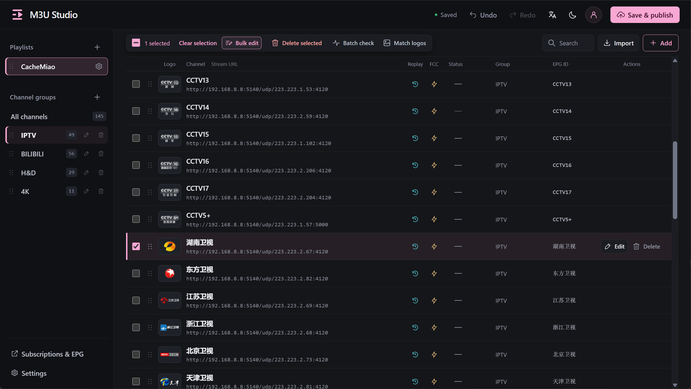
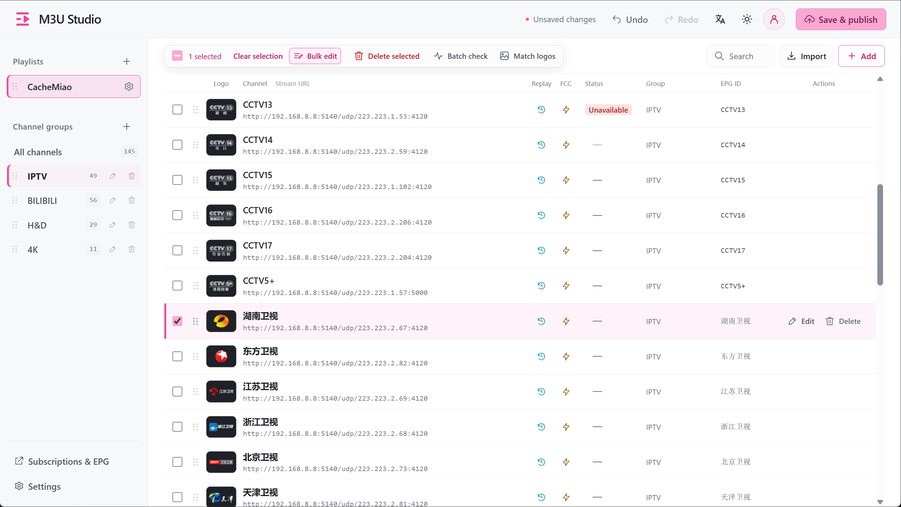

<p align="center">
  
</p>

<h1 align="center">M3U Studio</h1>

<p align="center">Organize IPTV channels. Publish your own subscriptions.</p>

<p align="center">
  <a href="https://github.com/cachemiao/m3u-studio/releases"></a>
  <a href="LICENSE"></a>
  <a href="https://hub.docker.com/r/cachemiao/m3u-studio"></a>
  <a href="https://github.com/cachemiao/m3u-studio/stargazers"></a>
  <a href="https://hub.docker.com/r/cachemiao/m3u-studio"></a>
</p>

<p align="center"><a href="README.md">简体中文</a> · <strong>English</strong></p>

<p align="center">M3U Studio is a self-hosted IPTV channel manager.<br>Organize channels, groups, logos and EPG in your browser, then publish <strong>M3U / TXT subscriptions</strong> for your player.</p>

<p align="center">
  <a href="#screenshots">Screenshots</a> · <a href="#features">Features</a> · <a href="#quick-start">Quick start</a> · <a href="#get-started">Get started</a> · <a href="#documentation">Docs and development</a> · <a href="#feedback-and-contributions">Contributing</a>
</p>

## Screenshots

<table>
  <tr>
    <td width="50%" align="center"><strong>Dark mode</strong></td>
    <td width="50%" align="center"><strong>Light mode</strong></td>
  </tr>
  <tr>
    <td width="50%"><a href="docs/images/channel-editor-en.png"></a></td>
    <td width="50%"><a href="docs/images/channel-editor-en-light.png"></a></td>
  </tr>
</table>

The interface and features above apply to **v0.6.0 and later**. Channels and logos are user-provided. [Watch the multi-select dragging demo →](docs/UserGuide.md#dragging-and-ordering)

## Features

- **Drafts and publish history:** browser draft autosave, undo/redo, review before publishing, and restoration of the last 30 pre-publish snapshots.
- **Automatic logo matching:** a searchable library, batch uploads and matching by name or alias; EPG and catch-up parameters.
- **Source checks and bulk edits:** check response times, replace URLs, edit fields and move or copy channels between playlists.
- **Playlists and subscriptions:** import M3U / TXT files, text or URLs; publish separate or combined subscriptions with custom short URLs.
- **Multi-select dragging:** move selected channels together, scroll automatically at the edges, and reorder playlists and groups.

## Quick start

> **Access:** deploy on a trusted LAN or VPN. Subscription and logo URLs do not require login; anyone who can access a subscription can read its stream URLs. For public deployment, configure HTTPS and access restrictions through a reverse proxy.

Install Docker and Compose, then run these commands. One configuration file pulls the **AMD64 / ARM64** image, with no repository clone, local build or `.env` required:

```sh
mkdir m3u-studio && cd m3u-studio
curl -fsSL https://raw.githubusercontent.com/cachemiao/m3u-studio/main/docker-compose.image.yml -o docker-compose.yml
docker compose up -d
```

Open **`http://SERVER_IP:8324`** and create your admin account; passwords require at least 8 characters. Data stays in the `m3u-studio-data` named volume.

**NAS:** paste the configuration below into your fnOS, Synology or other NAS Compose/project editor. You can also save it as `docker-compose.yml` in an empty directory and run `docker compose up -d`, without downloading a configuration file.

<details>
<summary>Copy the Compose configuration</summary>

```yaml
# Standalone image deployment: no source checkout or .env required.
# Save as docker-compose.yml, then run: docker compose up -d
services:
  m3u-studio:
    image: cachemiao/m3u-studio:latest
    container_name: m3u-studio
    ports:
      - "8324:8324"
    environment:
      TZ: Asia/Shanghai
    volumes:
      - m3u-studio-data:/data
    restart: unless-stopped
    security_opt:
      - no-new-privileges:true
    cap_drop:
      - ALL
    logging:
      driver: json-file
      options:
        max-size: "10m"
        max-file: "3"

volumes:
  m3u-studio-data:
    name: m3u-studio-data
```

Configuration file: [docker-compose.image.yml](docker-compose.image.yml).

</details>

[Other deployment methods, port changes, upgrades and backups →](docs/Deployment.md)

## Get started

1. Create a playlist and import M3U / TXT from a file, pasted text or a file URL. You can also add channels manually.
2. Organize groups and ordering, then configure logos, EPG, catch-up and FCC.
3. Review your changes and click **Save & publish**.
4. Open **Subscriptions & EPG** and copy a subscription URL to your player.

Channel changes update subscriptions only after publishing. Logo uploads, replacements and deletions take effect immediately. Back up the entire data directory for a full backup; JSON exports exclude images and accounts.

## Documentation

Built with **Python / Flask + SQLite** and plain HTML / CSS / JavaScript. No frontend Node build is required.

- [User guide](docs/UserGuide.md): imports, dragging, bulk editing, logos, EPG and subscription URLs.
- [Deployment and maintenance](docs/Deployment.md): installation, upgrades and backups.
- [Development and contributing](docs/Development.md): local setup without Docker, tests and the PR workflow.
- [Changelog](CHANGELOG.md)

## Feedback and contributions

Report bugs through [Issues](https://github.com/cachemiao/m3u-studio/issues) or contribute a [Pull Request](https://github.com/cachemiao/m3u-studio/pulls). Include your version, deployment method and reproduction steps in reports; read the [development guide](docs/Development.md) before contributing code. Remove private URLs and credentials from examples.

[Telegram channel](https://t.me/m3ustudio_news) · [Telegram group](https://t.me/m3ustudio_chat) · [X](https://x.com/cachemiao)

## License and scope

Released under [GNU GPL v2.0](LICENSE) (`GPL-2.0-only`). Copyright © 2026 cachemiao.

The project includes no live stream sources or TV channel logos. Use resources you have permission to use. It manages channels and distributes subscriptions; playback, UDP-to-HTTP conversion and catch-up depend on external services and players.

**FCC (fast channel changing)** targets multicast IPTV setups and requires a supporting service such as [rtp2httpd](https://github.com/stackia/rtp2httpd) and a compatible player.

<p align="center">
  <a href="https://cachemiao.github.io/m3u-studio/support.html?lang=en"></a>
</p>
