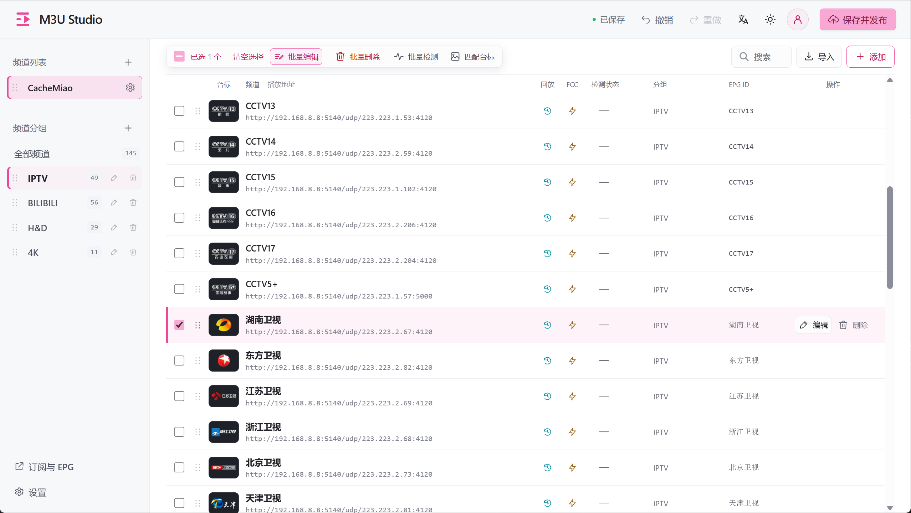

<p align="center">
  
</p>

<h1 align="center">M3U Studio</h1>

<p align="center">轻松整理 IPTV 频道，生成自己的订阅。</p>

<p align="center">
  <a href="https://github.com/cachemiao/m3u-studio/releases"></a>
  <a href="LICENSE"></a>
  <a href="https://hub.docker.com/r/cachemiao/m3u-studio"></a>
</p>

<p align="center">
  <a href="https://cachemiao.github.io/m3u-studio/support.html?lang=zh"></a>
</p>

<p align="center"><strong>简体中文</strong> · <a href="README.en.md">English</a></p>

M3U Studio 是一个可自行部署的 IPTV 频道管理工具。通过网页管理频道、分组、台标与 EPG，整理后生成 **M3U / TXT 订阅**，在播放器中使用。

## 界面预览


<details>
<summary>查看浅色模式</summary>



</details>

截图为即将发布的新版界面，当前公开版本可能有所不同。频道与台标由用户自行添加。

## 核心功能

- **多列表与订阅**：独立订阅、合并订阅、自定义短地址，支持 M3U / TXT 导入。
- **便捷整理**：搜索筛选、多选频道合并拖动、边缘自动滚动，支持列表与分组排序。
- **批量操作与检测**：编辑字段、替换地址、跨列表移动或复制，检测频道响应耗时。
- **台标与节目表**：台标库与自动匹配，配置 EPG、回放及 FCC 参数。
- **修改可恢复**：撤销 / 重做、浏览器草稿、最近 30 份发布前配置，以及 JSON 备份恢复。
- **外观与本地部署**：六种主题色、深浅模式、中英文界面与触屏操作；数据保存在本地，前端不依赖外部 CDN。

## 快速启动

先安装 Docker，以下两种方式任选其一。镜像支持 **AMD64 / ARM64**。

### 方式 A：Docker 命令

```sh
docker run -d \
  --name m3u-studio \
  -p 8324:8324 \
  -v m3u-studio-data:/data \
  -e TZ=Asia/Shanghai \
  --restart unless-stopped \
  --security-opt no-new-privileges:true \
  --cap-drop ALL \
  cachemiao/m3u-studio:latest
```

打开 **`http://设备IP:8324`**，首次访问时创建管理账号，密码至少 8 个字符。

数据保存在 `m3u-studio-data` 卷中。端口冲突时，将 `-p 8324:8324` 改为 `-p 8325:8324`，并通过 8325 访问。

### 方式 B：Compose 部署（推荐 NAS）

只需一个 Compose 文件，直接拉取官方镜像，**无需 clone 仓库、无需本地构建或配置 `.env`**。

**命令行**：在空目录运行：

```sh
mkdir m3u-studio && cd m3u-studio
curl -fsSL https://raw.githubusercontent.com/cachemiao/m3u-studio/main/docker-compose.image.yml -o docker-compose.yml
docker compose up -d
```

> 如果 `raw.githubusercontent.com` 无法访问，在 GitHub 打开 [docker-compose.image.yml](docker-compose.image.yml)，复制内容，在空目录中保存为 `docker-compose.yml`，再执行 `docker compose up -d`。

**飞牛 OS（fnOS）／群晖等 NAS**：打开 Docker 的 Compose／项目部署界面，新建项目，将 [docker-compose.image.yml](docker-compose.image.yml) 的内容粘贴到配置编辑器中启动即可，无需命令行。不同 NAS 的菜单名称可能略有区别。

默认从 Docker Hub 拉取 AMD64 / ARM64 镜像；数据自动保存在命名卷 `m3u-studio-data` 中，无需手动创建宿主机目录或设置写入权限。启动后访问 **`http://设备IP:8324`** 创建管理账号，无默认密码。

更多方式见 [部署与维护](docs/部署与维护.md)：Docker Compose、GHCR 镜像源、源码构建、升级和完整备份。

## 开始使用

1. 创建列表，导入 M3U / TXT 文件、粘贴内容或提供文件链接；也可以手动添加频道。
2. 整理分组与顺序，设置台标、EPG、回放和 FCC。
3. 检查修改，点击 **保存并发布**。
4. 打开 **订阅与 EPG**，复制订阅地址到播放器。

频道修改发布后才更新订阅；台标文件的上传、替换和删除立即生效。完整备份请保留数据目录，JSON 备份不包含图片和账号。

## 文档

- [使用指南](docs/使用指南.md)：导入、拖动、批量编辑、台标、EPG 和订阅地址。
- [部署与维护](docs/部署与维护.md)：安装、升级、数据备份及旧版本迁移。
- [更新记录](CHANGELOG.md)

## 反馈与交流

遇到问题或有功能建议，欢迎提交 [Issue](https://github.com/cachemiao/m3u-studio/issues)。请附版本、部署方式和复现步骤，示例中去除私人地址与凭据。

[Telegram 频道](https://t.me/m3ustudio_news) · [Telegram 群组](https://t.me/m3ustudio_chat) · [支持项目 ☕](https://cachemiao.github.io/m3u-studio/support.html?lang=zh)

## 许可与使用范围

代码采用 [GNU GPL v2.0](LICENSE)（`GPL-2.0-only`）许可证。Copyright © 2026 cachemiao。

项目不提供直播源或电视台台标，请使用有权使用的资源。它负责频道管理与订阅分发，播放、UDP 转 HTTP、回放和 FCC 能力取决于外部服务及播放器。推荐部署在可信内网或 VPN 中。

## Star History

<a href="https://star-history.com/#cachemiao/m3u-studio&amp;Date">
  <picture>
    <source media="(prefers-color-scheme: dark)" srcset="https://api.star-history.com/svg?repos=cachemiao/m3u-studio&amp;type=Date&amp;theme=dark">
    <source media="(prefers-color-scheme: light)" srcset="https://api.star-history.com/svg?repos=cachemiao/m3u-studio&amp;type=Date">
    
  </picture>
</a>
