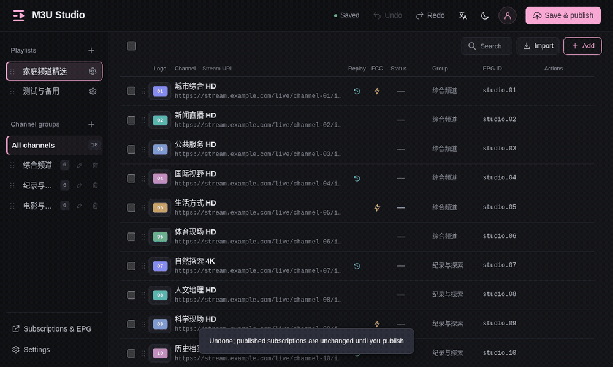

# M3U Studio user guide

[Home](../README.en.md) · [Deployment and maintenance](Deployment.md) · [简体中文](使用指南.md)

## Basic usage

1. Click **＋** beside **Playlists** and choose **Create empty playlist** or **Import as new playlist**. For an existing playlist, click **Import** to append M3U / TXT; the dialog shows the target playlist. You can also create groups and add channels manually.
2. Edit stream URLs, EPG, catch-up and FCC; choose or upload logos.
3. Organize using drag-and-drop, search, bulk editing and logo matching.
4. Review the draft and click **Save & publish**.
5. Open **Subscriptions & EPG** and copy subscription URLs to your player.

Channel changes update subscriptions after publishing. Unpublished changes applied to the playlist are saved in this browser and can be restored after reloading or signing in again. If the server configuration has changed, review it before publishing. Unsubmitted dialog forms are not included. If browser storage is unavailable, publish or export JSON promptly. Logo upload, replacement and deletion take effect immediately. Channel-logo assignments still require publishing; image changes cannot be undone through draft or publish history.

### Import results

Import normalizes commas in channel and group names to spaces, clears invalid logo URLs, sets unknown catch-up types to `default`, and replaces invalid catch-up days with 7. Unsupported stream protocols or channels that cannot be repaired are skipped. The report includes line numbers, names and reasons. Accepted channels must still satisfy publication validation.

Ordinary commas in TXT URLs are preserved; a comma immediately followed by another `scheme://` URL separates the catch-up URL. The report shows imported, repaired and skipped counts, with up to 1,000 detail entries. Imports only append channels and keep existing channels. If all channels are invalid, no playlist is created and the original playlist is unchanged. Duplicate channel IDs are adjusted automatically to avoid conflicts. If the form or playlist content changes during import, the result is blocked; review your changes and import again.

## Source response-time checks

1. Select channels to check, or leave the selection empty to check the entire current playlist.
2. Click **Batch check** to open the dialog, then click **Start check**.
3. View progress and results. You can cancel, filter failures, retry failures or recheck all channels in the current scope.

Click a channel's time or status badge to recheck that channel inline without opening the dialog.

- **≤300ms**: green; **>300ms**: yellow; **Timeout**: red.
- Up to 4 concurrent requests, with a 5-second timeout each. HTTP/HLS uses limited reads rather than continuously downloading the stream. UDP/RTP/RTSP is unsupported.
- Checks run from the deployment server. Response time does not measure player startup time or verify playback.
- Results are for reference and never delete or modify channels. Results stay on the current page and clear on reload. Closing the dialog cancels further checks.

### Move or copy between playlists

Select channels, open **Bulk edit**, and enable **Move or copy to another playlist**. Choose the action, target playlist and target group. Keep original groups, select an existing target group, or enter a new group name. Missing groups are created automatically and channels are appended to the target playlist.

**Copy** is selected by default and keeps the original channels. **Move** removes selected channels from the source and displays a red warning. Preview before applying; changes support undo. Click **Save & publish** when ready to update subscriptions.

## Subscription URLs

| Content | Path |
| --- | --- |
| Combined M3U | `/tv.m3u` |
| Combined TXT | `/tv.txt` |
| Playlist M3U | `/lists/PLAYLIST_ID/tv.m3u` |
| Playlist TXT | `/lists/PLAYLIST_ID/tv.txt` |
| Local logo | `/logo/CCTV1.png` |

**For long-term subscriptions on a TV, use a permanent ID URL**, such as `/lists/PLAYLIST_ID/tv.m3u`. Renaming the playlist or changing its subscription short name does not change this URL. After organizing channels, click **Save & publish** and refresh the existing subscription in your player; there is no need to enter the URL again.

Set a **Subscription short name** in Playlist settings, such as `home`. After publishing, use `/home.m3u` or `/home.txt`. Names are 1–24 ASCII letters, digits, underscores or hyphens, starting with a letter or digit. Names are lowercased, must be unique and cannot use reserved routes. Clear the name to disable it. Changing the short name invalidates the old short URL, so players using it need the new URL. Permanent ID URLs remain valid.

The web interface displays complete URLs. Renaming a playlist does not change its subscription ID. Subscriptions and logos do not require login. Your player must be able to reach the server.

## Dragging and ordering

Select several channels and drag the handle of any selected channel. They travel together in one card and keep their display order when dropped. Hold the pointer near the top or bottom of the channel area to keep scrolling. An insertion line indicates the drop position.

Drop the card onto a sidebar group to move all selected channels into that group. Dragging an unselected channel moves only that channel. Press Esc to cancel. Touch dragging and undo/redo are supported. Reordering is disabled while searching.

Switching playlists clears selection; searching or switching groups keeps it. Bulk actions include selected channels hidden by a filter. Playlists and groups can also be reordered by their handles.

## Language and appearance

Use the top language menu for Chinese/English and the theme menu for light/dark/system mode. **Settings → Appearance** offers pink, purple, blue, orange, green and cyan. New users start with pink and dark mode; existing browser preferences are preserved. These preferences do not require publishing or alter channel data.

## Logo library

Upload your own PNG/JPEG/WebP images, individually or in batches. The library supports search, name/alias matching and conservative fuzzy matching. Matching preserves distinctions such as CCTV5+ and 4K. Direct image URLs can also be assigned without adding them to the library.

Images are re-encoded as PNG and fitted within 300 × 180 without cropping or upscaling. Uploads are limited to 8 MB and decoded images to 16 megapixels. Duplicate names prompt you to replace the existing file or stop; stopping a batch keeps files already uploaded.

Image upload, replacement and deletion take effect immediately. Channel-logo assignments still require publishing. Image files are not rolled back by undo or publish history; include them in full data backups.

## EPG, catch-up and FCC

EPG uses existing XMLTV HTTP/HTTPS URLs. M3U aggregates global, playlist and channel guide URLs in `x-tvg-url`, with `tvg-id` for matching. An empty EPG ID falls back to the channel name. This app does not download or generate a local EPG file.

M3U catch-up uses `catchup`, `catchup-source` and `catchup-days`; TXT uses its third field. Playback support and placeholder formats depend on the server and player. TXT does not carry logo/EPG metadata. Unknown M3U extensions and comments are not retained.

FCC accepts `IP:port`, `udp://IP:port` or a URL containing `fcc=`. Export adds FCC to the stream URL query without duplicating the parameter, and import splits it back into the FCC field. Clear the field to remove the exported FCC parameter. Actual fast switching requires a supporting service such as [rtp2httpd](https://rtp2httpd.com/guide/fcc-setup).

## Undo, drafts and publish history

Undo/redo keeps up to 50 steps subject to a memory limit. Use Ctrl/Cmd+Z and Ctrl/Cmd+Shift+Z; text inputs keep native text undo. Reloading clears the undo stack, while applied unpublished drafts can be restored from browser storage. Unsubmitted dialog fields are not included.

Undoing after publishing creates a new draft; it does not immediately roll back published subscriptions. Settings keeps the last 30 pre-publish snapshots. Restore one into the draft, review it, then publish. Accounts, image files and the subscription host address do not roll back.

For complete backups, see [Deployment and maintenance](Deployment.md#data-and-backup).

## More screenshots

## Related resources

- [m3u-logos](https://github.com/cachemiao/m3u-logos): check the image permissions before use.
- [rtp2httpd](https://github.com/stackia/rtp2httpd): an external playback service with FCC support.

## Configuration and logo archives

Use **Settings → Configuration & logo backup → Export ZIP** to package all lists, the current applied draft and the entire local logo library, including unused images. External logo links are retained without downloading them. Accounts, session secrets and publication history are excluded.

**Restore backup** accepts this ZIP or legacy JSON. Configuration is validated and loaded into the draft; review it before publishing. Images join the library immediately. Identical files are reused; differing name conflicts receive new filenames and only the restored references change. Existing images are never overwritten or deleted. Missing image references are reported rather than silently removed.

The sidebar **Logo library → Export all** downloads every visible library image regardless of search filters. This image-only ZIP cannot restore configuration; extract it and use batch upload to import the images.

ZIP uploads are limited to 64MB, expanded content to 128MB and logos to 5,000 files. Legacy JSON retains its 8MB limit. Back up the full data directory to also migrate accounts and publication history.

## Version checks

The top-left logo and product name link to the project. Click the version number to check for updates. A short notice disappears after about four seconds; the accent-colored update dot stays visible when a newer release is known and links to the project. Failed checks are reported separately, never as “up to date.”

Automatic checks remain daily. Manual checks can refresh sooner, with a 60-second server cooldown against repeated requests. Checks do not upgrade containers or change channel data or drafts. The static demo displays its version without contacting the update service.
