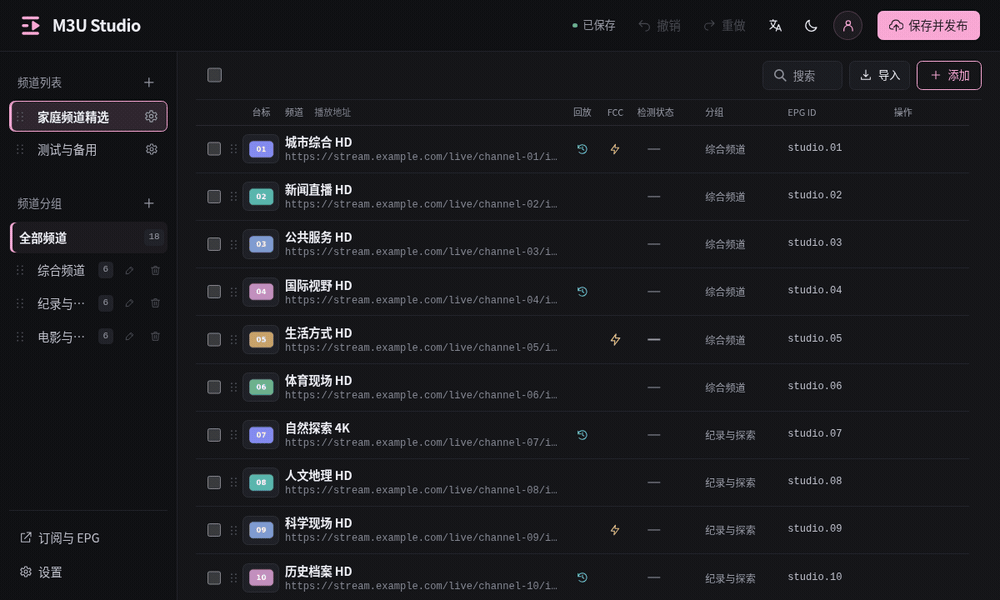

# M3U Studio 使用指南

[返回首页](../README.md) · [部署与维护](部署与维护.md) · [English](UserGuide.md)

## 基本使用

1. 点击左侧“频道列表”的 **＋**，选择 **新建空列表** 或 **导入并新建列表**；已有列表可点击 **导入** 追加 M3U / TXT，弹窗会显示目标列表。也可创建分组并手动添加频道。
2. 编辑播放地址、回放、EPG 和 FCC；选择台标，或上传自己的图片。
3. 使用拖拽、搜索、批量编辑和台标匹配整理频道。
4. 检查草稿，点击 **保存并发布**。
5. 打开 **订阅与 EPG**，复制合并或单列表订阅地址到播放器。

频道修改在保存并发布后更新订阅。已应用到编辑列表的未发布草稿会自动保存在当前浏览器，刷新或重新登录后可选择恢复；服务器配置变化时会提醒核对。尚未提交的弹窗表单不属于该草稿。浏览器存储不可用时请及时发布或导出 JSON 备份。

台标上传、替换和删除立即生效；频道与台标的绑定仍需保存并发布。台标文件不随草稿撤销或发布历史恢复。

### 导入结果

导入时会将频道和分组名称中的逗号规范为空格，清空无效台标地址，将未知回放类型设为 `default`、无效回放天数设为 7 天。不支持的播放协议或无法修正的频道会跳过，报告显示对应行号、名称和原因；修正后的频道仍需通过发布校验。

TXT 地址中的普通逗号会保留；紧接另一个 `协议://` 地址的逗号按回放地址分隔符解析。导入结果会列出导入、修正和跳过数量，详情最多显示 1000 条。导入只追加频道，保留已有频道；全部频道无效时，不创建新列表，也不改变原列表。重复频道 ID 会自动调整以避免冲突。导入期间表单或列表内容发生变化时，会阻止应用结果，请核对后重新导入。

## 源响应耗时检测

1. 选择需要检测的频道；未选择时检测当前列表全部频道。
2. 点击 **批量检测** 打开窗口，再点击 **开始检测**。
3. 查看检测进度与结果，可取消检测、筛选失败项、重试失败项或再次检测本次全部频道。

点击频道旁的耗时或状态标签，可直接重新检测该频道，无需打开检测窗口。

- **≤300ms**：绿色；**>300ms**：黄色；**超时**：红色。
- 最多并发 4 路，单路超时 5 秒；HTTP/HLS 仅有限读取，不持续下载直播流。UDP/RTP/RTSP 等协议暂不支持。
- 检测从部署服务器发起，响应耗时不代表播放器的出画面时间或实际播放效果。
- 结果仅供参考，不会自动删除或修改频道。结果保留在当前页面，刷新后清空；关闭检测窗口会取消后续检测。

### 跨列表移动与复制

选中频道后打开“批量编辑”，勾选“移动或复制到其他列表”，选择操作、目标列表和目标分组。可以保留原分组、选择目标列表已有分组，或输入新分组名称；缺少的分组会自动创建，频道追加到目标列表末尾。

默认选择“复制”，保留原列表频道；选择“移动”会从原列表移除所选频道，并显示红色提示。先预览再应用，支持撤销；确认后点击“保存并发布”更新订阅。

## 订阅地址

| 内容 | 路径 |
| --- | --- |
| 合并 M3U 订阅 | `/tv.m3u` |
| 合并 TXT 订阅 | `/tv.txt` |
| 单列表 M3U 订阅 | `/lists/列表ID/tv.m3u` |
| 单列表 TXT 订阅 | `/lists/列表ID/tv.txt` |
| 台标文件 | `/logo/CCTV1.png` |

**电视端长期订阅建议使用固定 ID 地址**，例如 `/lists/列表ID/tv.m3u`。修改列表名称或订阅短名称都不会改变该地址。日常整理频道后，点击“保存并发布”，播放器刷新原订阅即可，无需重新输入地址。

在“列表设置”填写订阅短名称，例如 `lt`、`yd`，保存并发布后可使用 `/lt.m3u`、`/yd.txt`。短名称支持 1–24 位英文字母、数字、下划线或短横线，以字母或数字开头；自动转小写且不能重复，也不能使用系统保留路由名称。留空使用原地址，修改短名称后原短地址失效，使用该短地址的播放器需要重新填写；固定 ID 地址继续有效。

网页会显示完整地址。列表改名不会改变订阅 ID；订阅和台标地址无需登录，播放器须能访问部署设备。

## 多选拖动与排序



- 勾选多个频道后，拖动任一选中频道的 `⠿` 把手，所选频道合成一张卡片移动，松手后按原显示顺序一起插入新位置。
- 指针停在频道区域顶部或底部时，列表自动滚动；插入色条表示放置位置。
- 拖到左侧分组可一起移动到该分组；拖动未选中频道时只移动该频道。按 Esc 可取消拖动。
- 支持触屏拖动、撤销和重做。搜索结果中关闭排序拖动，避免隐藏频道造成位置歧义。
- 列表切换会清空选择；分组切换和搜索保留选择，批量操作包含隐藏的已选频道。
- 列表、分组自身也可通过把手排序。“全部频道”固定在最前面；列表顺序影响合并订阅，分组顺序影响频道输出。

## 语言与外观

- 顶部语言菜单切换简体中文 / English，主题菜单切换深色 / 浅色 / 跟随系统。
- **设置 → 外观设置** 提供粉、紫、蓝、黄、绿、青六种主题色。新用户默认粉色与深色模式，已有浏览器偏好继续保留。
- 外观和语言在当前浏览器记忆，无需发布，也不改变频道、分组名称或播放地址。

## 台标库

- 点击频道台标，从左到右为 **台标库 → 上传 → 链接**。
- 台标库统一管理本地上传图片，支持搜索、选择和自动匹配；不再提供外置 GitHub 图库。
- 上传按图片原文件名入库，JPEG/WebP 转为同名 PNG。建议使用频道名称命名，方便匹配；中文、加号和括号受支持。
- 遇到同名台标弹出 **替换 / 停止**。替换保留图片地址，立即更新使用该图片的频道；停止保留原图。在批量上传中，停止会终止后续上传，已成功上传的图片保留。
- 设置 → 台标库管理：查看、搜索、批量上传、替换、删除。删除前提示已发布频道及当前草稿中的使用情况，确认后生效；频道地址不自动清空。
- 直接输入图片链接只绑定频道，不加入台标库。旧版已绑定的外置图片链接继续保留，图库管理入口移除。
- 台标库变更立即保存，频道绑定仍须保存并发布。图片文件和删除记录不随草稿撤销或发布历史恢复，请完整备份 `data/`。

支持 PNG/JPEG/WebP 上传，重新编码为 PNG，等比例缩小至 300×180 范围；不拉伸、裁剪或放大小图。上传请求上限 8MB、图片解码上限 1600 万像素。图片以原文件名保存为 PNG；覆盖同名台标必须明确选择替换。上传图片立即进入台标库，频道绑定在保存后发布。

公开版不内置电视台台标，请上传自己有权使用的图片。支持中文文件名和 `CCTV5+.png`；生成订阅时对中文路径进行 URL 编码。旧的 `HunanTV.png`、`CCTV5plus.png` 等英文地址通过别名映射继续可用，不在选择列表重复显示；旧台标需迁移到 data/logo 后继续使用。

升级不会覆盖 `data/logo/` 中用户上传的图片。管理界面可删除台标，重新上传同名图片可恢复使用。旧版随机文件名图片仍保留并可选择；它们没有频道名称，因此不保证按名称自动匹配。

## FCC

字段名称：**FCC（快速换台需使用rtp2httpd）**。

填写运营商 FCC 服务器 `IP:端口`，例如 `192.0.2.20:15970`，也接受 `udp://IP:端口` 或带 `fcc=` 的完整链接。导出 M3U/TXT 时自动将 FCC 写入频道直播 URL，例如：

```text
http://192.0.2.10:3224/rtp/239.125.2.1:4120?fcc=192.0.2.20:15970
```

现有其他查询参数保留，已有 `fcc=` 参数不会重复；导入 M3U/TXT 时会识别并拆分到 FCC 字段。清空此字段即可移除导出 URL 的 FCC 参数。`fcc-type=huawei` 等已有参数仍保留，可写在直播链接中。

填写原始 `rtp://`/`udp://` 组播地址时，会导出相同协议且附带 FCC 参数；需交由 rtp2httpd 的 M3U 转换功能处理后播放。本项目不内置 rtp2httpd，不负责运营商鉴权、接口配置或实际快速换台能力。

格式依据：[rtp2httpd 官方 FCC 文档](https://rtp2httpd.com/guide/fcc-setup)。

## EPG 与回放格式

EPG 采用已有 XMLTV HTTP/HTTPS 地址；M3U 的 `x-tvg-url` 汇总全局、列表与频道 EPG，`tvg-id` 对应节目表。当前不下载 EPG、不生成本地 `/epg.xml`。

M3U 回放使用 `catchup`、`catchup-source`、`catchup-days`；TXT 回放保留第三列，不再追加第四列 FCC，FCC 放在第二列直播 URL 查询参数内。回放占位符、时间格式与第三列支持取决于服务端和播放器。TXT 不携带 Logo/EPG 元信息。名称、分组不得包含逗号；含逗号的播放 URL 建议使用 M3U。未知 M3U 扩展属性和注释不保留。

订阅按已保存的 SQLite 当前状态即时生成，不另写 output 文件。应用提供文件分发，不负责把 UDP 转 HTTP，继续填写 rtp2httpd 等服务的播放地址。

## 撤销、草稿与发布历史

- 编辑撤销栈最多 50 步，并按内存限制裁剪。支持 Ctrl/Cmd+Z 和 Ctrl/Cmd+Shift+Z；输入框内保留原生文本撤销。
- 刷新后编辑撤销栈清空，但已应用到列表的未发布草稿可从当前浏览器恢复。未提交的弹窗表单不在草稿中。
- 保存发布后再撤销会产生新草稿，不会直接回退已发布订阅。
- **设置 → 发布历史** 保留最近 30 份发布前配置，恢复到草稿后检查并发布。账号、台标文件和订阅主机地址不会随历史回退。
- 完整备份与迁移见 [部署与维护](部署与维护.md#数据与备份)。

## 其他界面

### 台标库管理


### 订阅与 EPG


## 相关资源

- 台标资源可参考 [m3u-logos](https://github.com/cachemiao/m3u-logos)，使用前确认素材授权。
- FCC 需配合 [rtp2httpd](https://github.com/stackia/rtp2httpd) 等服务；[FCC 地址参考](https://rtp2httpd.com/reference/cn-fcc-collection)。
